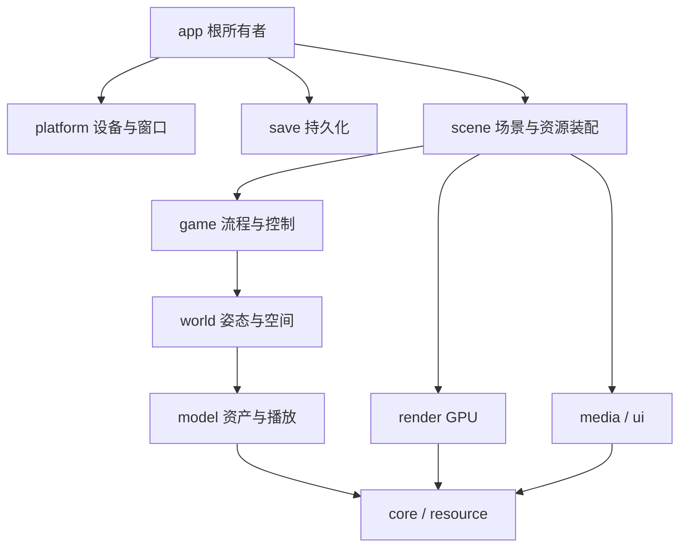

# 架构与所有权

本文维护当前模块边界和跨模块约定。功能接入与验证进度见[状态页](roadmap.md)，原指令和阶段实验见[报告索引](../reports/README.md)。修改局部算法时直接从对应代码、模块 README 和报告进入，无需读取全部历史记录。

## 模块与依赖

| 目录 / 目标 | 职责与边界 |
| --- | --- |
| `core/` · `bk_core` | 输入快照、数学、时钟、随机数、配置和文件替换/提交等公共 CPU 能力 |
| `resource/` · `bk_resource` | PP/TBL、图片、脚本和 FTT 解码，资源挂载及补丁覆盖；不创建 GPU 对象 |
| `model/` · `bk_model` | 模型、材质、动画、蒙皮、变形；依赖 core/resource，输出 CPU 数据 |
| `world/` · `bk_world` | 姿态与节点发布、路线、镜头、碰撞和空间查询；依赖 model/core |
| `game/` · `bk_game` | 角色行为、任务/阶段控制与有序服务请求；依赖 world，设备与文件由上层提供 |
| `ui/` · `bk_ui` | 精灵、字形排版、遮罩和文字时序，使用 CPU 资源 |
| `media/` · `bk_media` | PCM、混音/消费游标、AVI 解码与媒体时钟，设备输出由 platform 提供 |
| `save/` · `bk_save` | 检查点、记录、解锁、音量和图片文件；字段编解码、校验及替换 |
| `scene/` · `bk_entry_assets` / `bk_scene` | 组合真实资源、CPU 实例、UI/声音和 GPU 快照；前者可独立用于 CPU 检查 |
| `render/` · `bk_render` | 通用 GPU 资源、队列与绘制；Vulkan/native 类型留在实现与平台适配边界 |
| `platform/` · `bk_platform` | Switch / macOS / Linux / 离屏 host 的输入、窗口、时钟、日志和音频设备 |
| `app/` · `bk_app` | 启动、根所有者、持久化接入、场景转换与主循环 |

实际链接关系由 [CMakeLists.txt](../CMakeLists.txt)维护。CPU 的 core/resource/model/world/game/save 不直接依赖 libnx 或 Vulkan；scene 把 CPU 数据变成绘制快照，app 连接文件与平台服务。

## 状态与生命周期

app 持有进程级状态和服务：资源 store、renderer、音频设备、存档适配器、RNG、进度/记录、背包，以及跨场景保留的镜头、公共 UI 与控制状态。scene 借用这些服务，拥有该场景装配的资源和快照；服务寿命覆盖场景。构造失败按已经取得的所有者释放，不能用空对象成功掩盖资源或流程缺失。

同一原版共享字段由一个 owner 持有，其他组件借用或在明确调度边界导入/提交。背包来自 `PlaySession.game_state.pickup.collected`，音量来自进程级配置；不能在场景里另建值副本再当作实时状态。资源重载也不应重置本来跨场景保留的计时、RNG 或动作字段。

逻辑停止与物理销毁分开：先停止当前 owner 的声音和流程，保留末帧 GPU 快照完成提交，随后按已有退役边界释放。旧场景的晚回收不能停止新场景已复用的音槽、清空新状态或取消截图请求。参见[结局生命周期](../reports/ending-lifecycle.md)、[特殊场景](../reports/special-session.md)和[截图所有权](../reports/capture-lifecycle.md)。

## 姿态、帧顺序与时间

模型原始资产与运行实例分开；解码资产视为不可变，实例借用资产并拥有自己的播放状态、局部姿态和缓存。`step`、局部矩阵修改、节点遍历/`publish`、GPU 准备是不同操作。部分原版查询有意读取上次发布值，不能为“同步”而在任意位置刷新整棵树。

应用按原版顺序组合游戏控制、世界/演员更新、媒体和 UI，准备快照后提交绘制。资源上传/释放与可变缓冲更新放在 renderer 允许的帧边界；零步重绘消费已有快照，不重复推进剧情、RNG、音频或存取文件。

生产游戏步长恢复原版两帧测量规则，`game/wall≈2` 的计数不表示游戏跑了两倍速。媒体、逻辑和设备消费时钟各有用途，不能通过减半所有 dt、固定递增计数或墙钟猜测替代。详见[原版速率](../reports/game-clock-fps.md)、[节点发布](../reports/frame-tree.md)和[固定动画调用](../reports/fixed-animation.md)。

## 渲染契约

CPU 变换使用行向量 `world = local * parent`、`MVP = world * view * projection`；矩阵字节供 GLSL 列主序读取，等效转置。公开投影深度为近 0 / 远 1；Vulkan 内部的反向深度、比较与清除属于 renderer 适配，不能反向修改游戏镜头数学。

UI 使用固定 1280×960 逻辑画布，布局、动画、光标和命中测试共用该坐标；窗口缩放不修改这些状态。平台将事件转换为 drawable 像素，scene 经 `ui/canvas.h` 映射到逻辑画布。GPU viewport/scissor、3D 特殊视口和截图裁切使用物理 4:3 内容区域；UI 投影尺寸允许大于 drawable，但仍检查合法上限。绘制附加帮助前恢复全屏区域；帮助不进入相册照片。

网格、纹理和灯光由创建它们的 renderer 管理，CPU 解码器不执行 GPU 上传。scene 负责全局有序提交、透明层和显式灯光快照，renderer 不推断角色或剧情。背景稳定透明层与阴影深度偏移是明确的兼容策略，不能当作原指令严格等价；见[表面明暗修复](../reports/lighting-surface-layers.md)及[视口原点差异](../reports/ending-raster-origin.md)。

## 资源、语言与存储

资源引用通过 `(pack, name)` 读取，后挂载的同 pack 覆盖先挂载者；pack 之间不串用。选中资源损坏或读取失败要报错，不能回退旧内容掩盖错误。当前 `FILE *` 读取路径没有承诺并行访问，增加异步加载时需明确文件句柄与调度所有权。

BKPT2 外挂由资源层解压并应用，场景从 `BK_PATCH_CHINESE` / `BK_PATCH_UNCENSORED` 选择相应适配。FTT 直接以双字节索引；中文标签使用 GBK，日文使用 Shift-JIS，字库覆盖本身不做转码。[补丁说明](patches.md)集中维护这项约定。

save 显式编解码字段，不转储 C 结构体或指针。缺失、损坏和写入失败分开处理；损坏文件不能按空档覆盖。设置与 save 共用 core 的文件替换、备份恢复和提交服务；app 取得平台后、打开存档适配器前安装提交回调，关闭平台后清除，CPU 模块不直接调用 libnx。多个持久化文件分别提交，不声称跨文件事务或断电持久性；见 [save 模块](../runtime/save/README.md)。

## 原版对照与生产适配

原生地址只适用于[移植记录](../reports/porting.md)指定摘要的中文 EXE。严格 CPU 入口保留已恢复的校验与调用顺序，平台或已知原版异常由明确适配层处理，其他非法状态继续拒绝。

例如结局副镜头重置哨兵 `-1` 仅在生产事件适配中暂用主镜头，不能放宽所有非法索引；见[侧栏修复](../reports/ending-sidebar.md)。固定路线 flag 槽和有效运动节点也有不同边界，见[保存后交接](../reports/checkpoint-next-story.md)。需要修改这些路径时再查其细节和相关测试。
